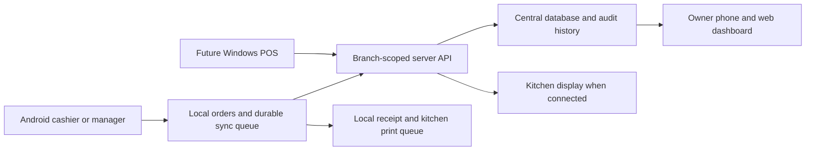

# Restaurant POS: Android first, Windows next

Prepared 2026-10-16. Status: researched product and implementation plan; no new POS application, APK, production deployment, or manager distribution completed.

## Product decision

Build an owned restaurant POS that handles a complete manager shift on an Android phone or tablet, supports branches from its first data model, and later runs on Windows. Keep routine selling fast and usable during an internet outage. Use the existing smartpos-ai repository for continuity, with a new transaction core and native client; reuse suitable existing components only after verification.

The first restaurant, first branch, manager device, and printers are awaiting confirmation. Mithaiwala Bur Dubai is a working menu-source candidate, not a confirmed launch selection. Do not create active branches from historical menus. Multiple brands can share an owner dashboard while retaining separate legal entities, menus, staff permissions, tax settings, and financial records.

The immediate deliverable is this plan. A training APK and a live pilot are separate milestones. Live rollout requires owner approval after the preview and actual-device checks.

## Benchmark and intended advantage

OrderPin publicly lists ordering, tables, staff permissions, inventory, customer management, reporting, payments, branch menu synchronization, transfers, and kitchen displays. These are baseline capabilities to plan against, not claims that our system already matches them. Source: [OrderPin POS](https://www.orderpin.co/products-pos/) and [branch management](https://helpcenter.orderpin.co/docs/Branch-stores-management), reviewed 2026-10-16.

Our proposed advantage is fit for this operation: fast photo ordering; sweets by weight and pack; branch/channel pricing; visible cash differences; reliable recovery after outages; traceable discounts and refunds; and an owner view that shows when a branch last synchronized. These are design goals. Prove them in the pilot before claiming superiority.

## Users and devices

| User | Primary device | Allowed work |
|---|---|---|
| Owner | Phone and web dashboard | All authorized branches, price publication, staff roles, reports, approvals, exports |
| Branch manager | Android tablet or phone | Assigned branch, shift close, permitted discounts/refunds, stock availability, printer recovery |
| Cashier | Android counter device | Open own shift, sell, take tenders, print, hold/reopen own permitted orders |
| Waiter | Android phone, expansion phase | Assigned tables, order entry, kitchen submission; no unrestricted refunds or cash adjustments |
| Kitchen staff | Kitchen screen or printed tickets | Assigned preparation stations, preparation and ready status |
| Accountant | Web, expansion phase | Read/export reconciliation and records, no routine cashier authority |

Use named staff accounts and a fast device-bound PIN unlock after enrollment. Manager approvals must identify the approving person. Owner login uses stronger authentication; PIN attempts are limited. Server-side authorization must enforce branch access, even if a client requests a different branch ID.

## Feature scope

P1 = first manager pilot; P2 = wider branch operation; P3 = growth and integrations. “P1” means required before real sales unless a documented, owner-approved pilot limitation applies.

| Area | P1: manager APK | P2: branch expansion | P3: optional growth |
|---|---|---|---|
| Catalogue | Photos, categories, search, favourites, item codes, variants, add-ons, item notes, sold-out status | Scheduled menus, controlled bulk changes, branch overrides | Menu engineering and promotion suggestions |
| Sweets/bakery | Piece, pack and manually entered weight; validated units and price basis; configurable 250g/500g/1kg packs | Mixed boxes, production batches, expiry tracking | Supported weighing-scale integration |
| Orders | Takeaway, basic table/dine-in assignment, manual delivery orders, hold/resume, quantity edits | Visual table plan, seats, table transfer/merge, courses, split bills by item | QR self-ordering, kiosk, catering bookings |
| Checkout | Cash, externally processed card recorded by staff, mixed tender, change, receipt, exact amount reconciliation | Configured additional tender types, deposits/credit with explicit rules | Approved payment-terminal integration |
| Corrections | Manager-approved void/refund, mandatory reason, original sale link, immutable audit history | Approval limits, remote approval, exception alerts | Advanced fraud/anomaly review |
| Kitchen | Kitchen ticket per configured station, order number, modifiers, revision/cancellation tickets; visible failures | Multi-station kitchen display, preparation timers, dispatch screen | Preparation forecasting |
| Shifts | Opening float, cash in/out with reason, counted cash, expected cash, variance, close report | Handover approvals, branch comparison | Advanced labour analysis |
| Branches | Organization/brand/branch structure, assigned users/devices, branch-specific prices and settings, isolated test of two branches | Central publication, manager comparison, stock transfers | Franchise restrictions and consolidated analytics |
| Offline | Cached catalogue, local durable sales, receipts, durable synchronization queue on primary device | Tested local branch coordination where required | More complex offline multi-device service |
| Owner mobile | Sales and tender totals, open shifts, discounts/refunds, last-sync time and incomplete-data labels | Stock, kitchen delays, branch comparisons | Forecasts and approved business alerts |
| Inventory | Manual availability and sold-out controls; no invented live ingredient balance | Purchases, receiving, waste, counts, recipes, yield, transfers | Supplier workflows, suggested reorder |
| Delivery platforms | Manually entered channel and unique external order reference; separate channel prices | Settlement import/reconciliation | Official approved Noon/Talabat/Deliveroo/Keeta connectors where access exists |
| Customers | Optional name/contact and delivery details when needed; guest checkout | Purchase history and consent-based loyalty | Customer ordering app and marketing integrations |
| Languages | English UI; Unicode menu names and tested Arabic receipt rendering where required | Full Arabic UI/RTL; staff languages chosen with manager | Optional voice ordering with human confirmation |
| Reports | Daily sales, tender totals, refunds, discounts, channel totals, cash variance, item quantities; CSV export | Recipe contribution and channel settlement reconciliation | Forecasting after sufficient reliable data |
| Reliability | Backups, restore drill, crash recovery, audit log, diagnostics, signed APK update preserving data | Managed device enrollment and staged releases | Larger fleet administration |

No automated messages, marketing, platform publications, or money movement are enabled simply because the feature appears in this roadmap.

## Manager workflow and screen plan

Opening: unlock → check branch/device → open shift and enter float → check printer and catalogue version.

Selling: choose order type/table → tap photographed items → select required modifiers/weight → review basket → send kitchen ticket → collect and record tender → receipt → mark handover/delivery.

Kitchen and payment status are separate: an unpaid dine-in order may already be cooking, and a paid order may still be preparing. Model each explicitly.

Closing: review open/unpaid orders and synchronization issues → count cash → explain variance → close shift → owner sees the report with freshness status.

Phone navigation: Sell, Orders, Shift, More. Sell uses a two-column image grid and a persistent basket button. The cart and tender screens use full-height focused views. Owner screens use a separate role view.

Tablet layout: category rail, image catalogue, persistent basket; visible branch, shift, connectivity, and kitchen delivery state. Windows later adds keyboard shortcuts, mouse navigation, resizable panels, barcode input, and native printing.

Design checks: at least 48 logical-pixel primary targets, readable item names and prices, no colour-only status indicators, no horizontal overflow at approximately 375px, and equally clear portrait/landscape layouts. Real product pictures retain their aspect and do not imply an unverified portion. Validate branding from authentic assets after the restaurant is selected.

## Menu and image intake

Verified local archive: `Mithaiwala-Noon-Images-Backup-2026-08-20` beside this repository. The catalogue timestamp is 2026-08-20T16:10:13.068Z, not today's live menu.

Recounted on 2026-10-16: 133 items across 18 categories, 125 populated and unique image paths, 125 files in the existing Noon image library, and 41 files in the commissioned photo collection. These counts do not certify every image-to-product mapping or today's selling price.

Eight records lack images: SAMOSA PAV, VADA PAV, Matka lassi, TOAST, Kismis Aflatoon, Matka Lassi, Maska butter, and Meal. Case variants such as the two Matka Lassi records need review against codes, category and portion; do not automatically merge them by name.

Sources in order:

1. Fresh authorized restaurant menu export, once accessible, for current channel records.
2. Restaurant-approved counter menu for actual POS prices and units.
3. Existing Noon image library and commissioned camera photographs, mapped and reviewed.
4. Older printed and May 2026 exports only to identify potential missing items.

The archived generated candidates and rejected drafts must not enter the POS catalogue automatically. Use an honest placeholder where an approved image is missing.

Intake pipeline: preserve source copy → normalize into a staging catalogue → validate codes, duplicate candidates, units and modifiers → match images by source identity → show import differences → manager reviews price/availability/portion → publish a versioned catalogue to selected branches. Reimport must update matching source codes without duplicating products or erasing local approved overrides.

Each staged item needs: stable product ID, source platform/code and capture date, category, English/Arabic names where available, description, image provenance and approval, sale unit, variant, integer price in fils, channel/branch price, configured tax category, availability, preparation station, modifiers, and optional verified allergen information. Do not infer allergens or portion weights from photographs.

Noon delivery prices must remain separate from counter prices unless explicitly confirmed equal. Importing a Noon menu does not establish automatic Noon order integration.

Live refresh attempt on 2026-10-16: the Noon partner welcome page remained on a loading spinner in Chrome. No current authenticated catalogue was read. Current prices, item availability, modifiers, and branch assignments remain unverified.

## Technical recommendation and reuse

Recommend Flutter for the Android/Windows transaction client, a local SQLite database and outbox, and a branch-scoped API backed by PostgreSQL. Retain or adapt the existing Next.js owner administration interface and Supabase services if the implementation review confirms they meet requirements. Exact database, sync and hardware libraries must pass a small compatibility prototype before being fixed.

Flutter officially supports Android and Windows. Sharing the client does not make printer adapters, installation or platform testing automatic. Windows builds need a Windows build environment; this Ubuntu machine can remain the main Android development machine. References: [supported platforms](https://docs.flutter.dev/reference/supported-platforms), [build environments](https://docs.flutter.dev/platform-integration), [Windows packaging](https://docs.flutter.dev/platform-integration/windows/building).

Alternative: package the current web UI with a native wrapper and later a desktop shell. It could reuse more UI, but still needs durable offline storage, synchronization and hardware integration. Given the stated Android-plus-Windows goal, select Flutter provisionally; confirm with a printer/offline proof of concept before a full UI build.

Source audit completed 2026-10-16; existing integrations were not executed. Existing reusable candidates include order parsing, menu extraction, kitchen board concepts, owner queries, WhatsApp workflows and cloud-print adapters. They are optional components, not validated operational dependencies.

Current gaps found in source:

- No APK/Windows packaging, local database, offline outbox, branch entity, photo catalogue or ordinary checkout flow.
- Existing Stripe use is software-subscription billing, not payment collection against restaurant orders.
- Order and line writes are separate; transactional creation and duplicate prevention need redesign.
- Printing lacks a demonstrated durable recovery queue; cloud print alone does not provide local Android offline printing.
- End-to-end order tests and row-security integration tests are skipped; existing unit tests mostly mock external services.
- Some dashboard failures become zero values. New reports must show unavailable/incomplete state instead.

Evidence within this repository: `package.json`, `supabase/migrations/20260531000000_init.sql`, `app/(app)/order/page.tsx`, `components/order/OrderCart.tsx`, `lib/printing/printnode.ts`, `tests/e2e/order-flow.spec.ts`, `tests/unit/db/rls.test.ts`, and the historical `docs/superpowers/specs/2026-05-31-smartpos-ai-design.md`. The old scope explicitly excluded a full POS; this plan proposes a separate expanded product direction without rewriting that history.

## Transaction and offline rules

- Hierarchy: organization/legal entity → brand → branch → device → shift. Every sale, payment, refund, cash movement and kitchen ticket carries the required branch/device/actor identity.
- Money uses integer fils; weights use fixed precision and explicit units. Discounts, tax and rounding follow a documented calculation order with worked tests approved for the configured business.
- Snapshot item names, quantities, unit prices, discounts and tax settings on the sale. Later catalogue edits cannot rewrite previous receipts.
- Commit each business command atomically: order submission writes the order, lines and kitchen/outbox event together; later collection writes tenders, payment state, audit and outbox together. Give every command a unique ID; retrying the same command must not create another sale, tender or refund.
- Keep payment states distinct: pending, staff-recorded external tender, provider-confirmed where integrated, failed, refunded. The first APK records a successful standalone card-terminal payment; it does not charge a card or independently confirm a bank settlement.
- For an uncertain terminal result, reconcile the terminal/reference before retrying. Never store card numbers or CVVs.
- Refunds and voids append linked corrections with reason and approver. No silent deletion or editing of paid sales. Separate recording a refund from actually moving money.
- Cap cumulative refunds at the eligible original paid amount per sale/tender, with transactional concurrency checks across different command IDs and devices. Offline refunds are limited to eligible locally available sales owned by the authorized primary device, with exclusive refund authority until reconciliation; all others wait for online verification. Do not allow a second device or server session to independently refund the same sale while that authority is offline.
- Local database commits before the UI reports a saved sale. Queue retries survive force-stop and device restart. Show pending sync count, errors and last successful sync.
- A server or dashboard must not label a branch total complete while devices have unsynchronized sales. Remote stock and reports are stale during an outage.
- Pilot offline policy: one primary selling device per branch during disconnection. An order remains owned by its creating device until server coordination is available; another offline device cannot settle the same shared table order. Concurrent offline shared tables are not a P1 promise.
- Offline primary-device takeover is blocked until the old device is reconciled, or an explicit recovery procedure prevents both devices from continuing to sell or refund under the same authority.
- Separate kitchen displays cannot receive new orders through an unavailable cloud connection. Use a verified local printer route or a documented manual kitchen fallback. Local-network KDS coordination is a separately tested expansion.
- Printer jobs have stable ticket/revision IDs. Distinguish queued, sent and physically verified where hardware supports it. A network acknowledgement is not always proof of paper output; uncertain jobs require staff review. Reprints visibly say COPY and never resend an order as a new sale.
- A lost/destroyed device can lose sales that have never left it. Show that exposure, support encrypted recovery exports, and test restore. Cloud backups alone cannot protect unsynchronized local orders.
- Offline staff authorization has a bounded validity policy; revoked users cannot retain indefinite access. Higher-risk actions may require online approval or an enrolled manager according to configured limits.

## Reports, data and administration

P1 reports must separate gross sales, discounts, net sales, configured tax, refunds, tender collections, unpaid orders and cash movements. Do not call sales “profit.” Ingredient costs, yield, platform commissions, packaging and overhead must be available before their corresponding margins can be reported reliably.

Cash expectation: opening float + cash collections + authorized cash-in − cash refunds − authorized cash-out. Compare it with counted cash, retain the difference, and log who approved the close. A shift can cross midnight; branch business-date and cutoff rules are explicit.

Delivery-platform settlement reporting later separates order sales, platform-funded and restaurant-funded promotions, fees, refunds and payout reconciliation. Manual platform orders must not inflate counter cash or card-terminal totals.

Configure legal name, branch address, tax registration/status and receipt requirements from the business's verified records. Obtain accounting review of example sales, discounts, returns and invoices before live use; tax compliance and any electronic invoicing obligations are not certified by this plan.

Protect customer details and branch records through least-privilege access, encrypted transport, secure device credential storage, backup controls and minimal support logs. No customer exports, secrets, signing keys or production databases in Git. Confirm backup retention and hosting region before production setup.

## Hardware and APK handover

Before choosing a printer library, record the exact Android device/OS and receipt/kitchen printer model, paper width, network/Bluetooth/USB connection, Arabic capability, and cash-drawer interface. Test actual output; a generic ESC/POS label is insufficient evidence of compatibility. Existing cloud printers may be usable online but do not settle the offline requirement.

Provide a signed release APK, version/build number, checksum, release notes, short manager guide, and a separately identifiable training environment. Protect and back up the signing key outside Git. Android requires signed APKs, and update continuity depends on the signing setup: [Android app signing](https://developer.android.com/studio/publish/app-signing).

Handover sequence: approved training APK → install on manager's actual device → verify catalogue and printers → complete scripted practice shift → record issues → approved live branch activation → observed pilot shifts → wider rollout. Distribution or a successful install alone is not acceptance.

Updates must preserve local orders, unsynchronized queue and settings. Test migrations on a copy and establish a compatible recovery procedure; simply reinstalling an old APK can break a newer database. Never uninstall a live device to update it while unexported data remains.

## Build stages and exit criteria

Indicative effort below is a planning range, not a deadline. It assumes one pilot branch, one primary Android counter, existing payment terminal, one confirmed printer family, no automatic aggregator integration, and prompt operational feedback. Re-estimate after the compatibility prototype; hardware and integration approvals can add elapsed time.

| Stage | Indicative focused effort | Deliverable and exit condition |
|---|---|---|
| 0. Confirm operation and catalogue | 2–4 working days | First brand/branch and hardware confirmed; reviewed item/price/image mapping; sample receipt rules agreed |
| 1. Interaction and hardware proof | 3–5 working days | Phone/tablet preview reviewed; local save, restart recovery, real printer and basic sync demonstrated |
| 2. Transaction foundation | 8–12 working days | Branch permissions, catalogue, manual ordering, checkout, audit, shifts, local storage and transactional sync tested |
| 3. Manager beta | 5–8 working days | Signed APK, verified kitchen/receipt handling, reports, offline recovery, training guide and restore test |
| 4. Controlled live pilot | 3–5 observed shifts plus fixes | Owner-approved activation; actual cash/tender/order reconciliation; manager acceptance; outstanding issues resolved |
| 5. Branch expansion | Re-estimate after pilot | Second real branch and concurrent-user testing; centralized menu changes; optional KDS/inventory modules |
| 6. Windows release | Re-estimate with hardware | Windows build/signing setup, installer, peripherals, keyboard UX, update and offline tests on actual Windows hardware |

Stages 0–3 total approximately 18–29 focused working days under these assumptions, before live pilot observations and fixes. This is not a commitment to unattended completion or a production-ready APK today.

No new hardware or paid subscription has been authorized. Cost worksheet before procurement: existing/new devices and printers; server/database/storage; backups/monitoring; any printing service; optional SMS/WhatsApp usage; payment-provider fees; Windows build/signing/distribution; maintenance and support. Obtain live quotes after selecting providers. Keep AI usage optional so routine checkout has no AI dependency.

## Acceptance checklist for the first live branch

- [ ] Approved source catalogue and counter prices, including weights/packs/modifiers and missing-image handling.
- [ ] Correct phone layout near 375px and actual tablet portrait/landscape; owner desktop layout verified.
- [ ] Complete cash, card-recorded, mixed-tender, change, discount, unpaid-order, cancellation and refund scenarios with exact totals.
- [ ] Kitchen changes print only required revisions; printer disconnect/retry/reprint do not create duplicate sales or misleading kitchen tickets.
- [ ] Start offline, sell, force-close, reboot, reopen and synchronize without missing or duplicate orders/tenders; startup-after-enrollment policy tested.
- [ ] Two-device online conflict tests; P1 offline single-device restriction enforced and explained.
- [ ] Second test branch cannot read or modify another branch's restricted records; cashier cannot escalate to manager.
- [ ] Shift spanning midnight closes correctly; counted cash, variance and exports reconcile to source records.
- [ ] Owner report marks pending/offline/unavailable data accurately.
- [ ] Backup restored to a replacement test device; app upgrade preserves historical sales and queued transactions.
- [ ] Signed release APK installed and used on the manager's actual device with actual printers.
- [ ] Meaningful transaction/integration tests pass, skipped critical tests replaced, scoped Semgrep review evaluated for new auth/payment/input code, and secrets excluded from repository/artifacts.
- [ ] Manager completes a practice shift and understands recovery, reprint, refund and shift close.
- [ ] Owner approves live activation and fallback process; retain the existing operational method until pilot reconciliation succeeds.

Suggested pilot targets, to be agreed with the manager: no unexplained missing or duplicate sales; all observed shift differences accounted for; offline recovery reconciles exactly; typical three-item ordering is acceptably fast on the actual device; every failed kitchen dispatch is visible. Do not label these tested until evidence is recorded.

## Decisions needed next

1. Restaurant/brand and first branch; other active branches to provision later.
2. Manager's Android phone/tablet model and OS; printer models and connections.
3. Whether first use includes dine-in tables, sweets by weight, takeaway, delivery and/or catering; number of concurrent selling devices.
4. Approved counter prices and tax/receipt configuration, distinct from platform menu prices.
5. Which existing process remains available during the pilot and who signs off shift reconciliation.

The first two were requested during planning. The remaining details can be collected with the manager during Stage 0. Source research and this plan do not require those answers; production configuration and meaningful device acceptance do.
